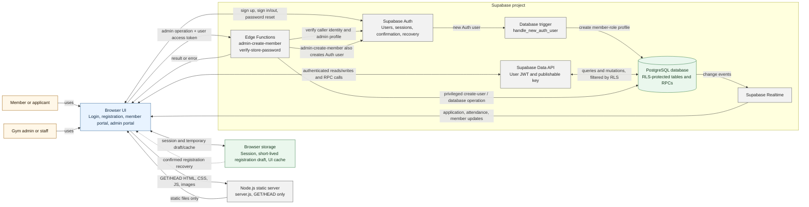

# Iron Grind System Data Flow

## System Diagram

## How Data Moves

1. **Pages and assets:** A member or staff member loads the website in a browser. The Node.js server returns static files only; it does not receive membership, attendance, or sales API requests.
2. **Sign-in and identity:** The browser uses Supabase Auth for account creation, sign-in, sign-out, email confirmation, and password recovery. On account creation, a database trigger creates a corresponding `profiles` row. The Auth session supplies the user identity for later database requests.
3. **Online registration:** Registration creates an Auth user and submits the applicant's details as a `pending` row in `membership_applications`. If email confirmation is required, a password-free draft is kept in browser storage temporarily and submitted after confirmation/sign-in. Admin review updates the application; approval creates or links the member record and records membership payment data.
4. **Member portal:** An authenticated member reads their own `members` row, attendance history, and active products; submits renewal requests to `membership_applications`; and saves personal settings through the `update_own_member_personal_info` RPC. Attendance/member changes can be pushed back to the page through Supabase Realtime.
5. **Admin portal:** Admin pages read and manage applications, members, products, attendance, sales, and membership history. Common operations use the authenticated Data API and database RPCs. Walk-in sales and membership operations are handled by database functions so related records can be written together.
6. **Privileged admin actions:** `admin-create-member` verifies the caller's Supabase session and `profiles.role`, then uses server-held service credentials to create the Auth user and invoke the database operation that creates the member and sale. `verify-store-password` also checks the authenticated admin role, then compares the submitted password with a server-side secret; it does not create a database record.
7. **Live updates:** Database changes to applications and attendance are sent through Realtime subscriptions to refresh admin views. A member's name and attendance updates can also be sent to that member's browser.

## Data Stores and Access

| Store | Main data | Typical access |
| --- | --- | --- |
| Supabase Auth | Credentials, user IDs, sessions, email confirmation and recovery | Supabase Auth client; privileged user creation only inside the Edge Function |
| `profiles` | Email, username, full name, `admin`/`member` role | Authenticated user reads their profile; admin checks are evaluated by database policy or Edge Function |
| `membership_applications` | Registration and renewal details, signature, review status | Member submits their own pending application; admin reviews and updates applications |
| `members` | Approved membership and personal details | Member reads their linked record; admin manages member records |
| `attendance` | Check-in/check-out timestamps and recorder | Member reads their own attendance; admin records and manages attendance |
| `products` | Product, price, stock, and active status | Authenticated users read active products; admin manages inventory |
| `sales`, `sale_items` | Receipts and line items | Admin manages sales; members can read sales linked to themselves where applicable |
| `membership_history` | Expiry, renewal, and plan-change history | Admin manages history; members can read their own history |
| Browser storage | Login routing/session state, temporary registration recovery draft, and UI/local fallback data | Local to that browser; not the authoritative shared system record |

## Security Boundary

The browser contains a Supabase publishable key, not a service-role key. Authenticated Data API requests are constrained by PostgreSQL Row Level Security (RLS). Edge Functions independently validate the caller's Auth user and admin role; only server-side function configuration contains privileged credentials. The role stored in browser session storage is used for page routing and is not sufficient authorization by itself.

## Code References

- Static server: [server.js](../server.js)
- Browser Supabase client: [assets/js/supabase-client.js](../assets/js/supabase-client.js)
- Login and registration: [assets/js/auth.js](../assets/js/auth.js), [assets/js/register.js](../assets/js/register.js)
- Member portal: [assets/js/customer.js](../assets/js/customer.js)
- Admin portal: [assets/js/admin.js](../assets/js/admin.js)
- Tables and RLS policies: [supabase/schema.sql](../supabase/schema.sql)
- Admin member creation: [supabase/functions/admin-create-member/index.ts](../supabase/functions/admin-create-member/index.ts)
- Store password verification: [supabase/functions/verify-store-password/index.ts](../supabase/functions/verify-store-password/index.ts)